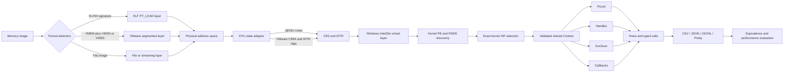
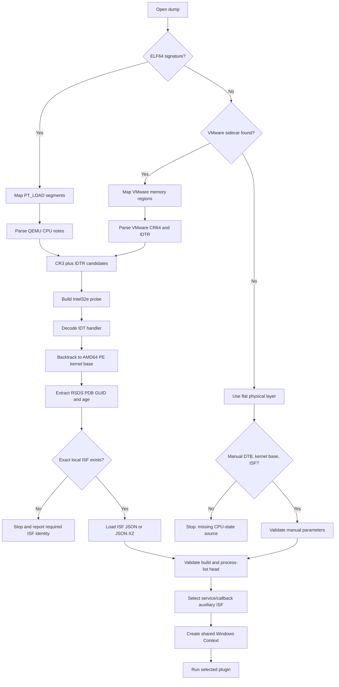
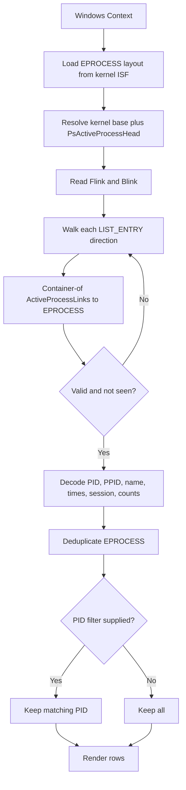
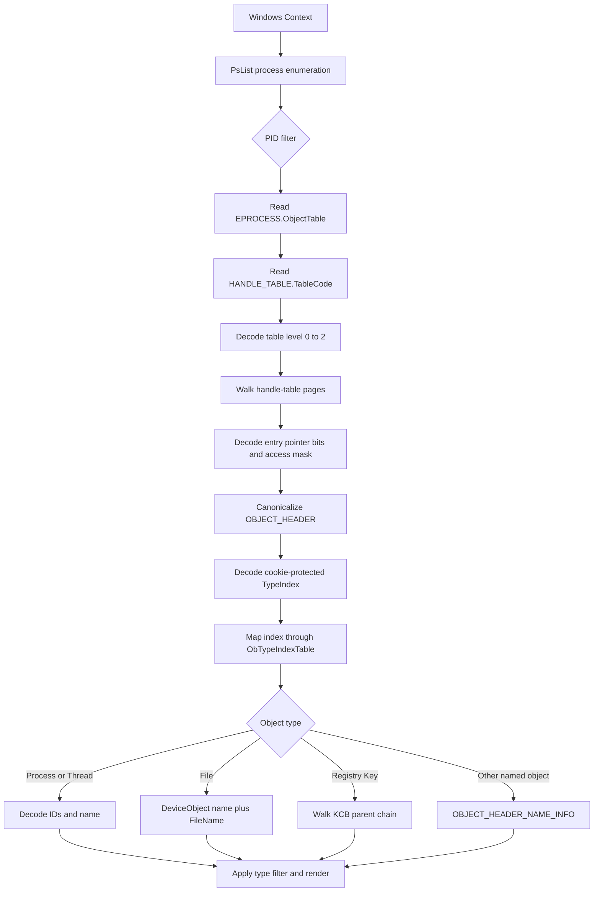
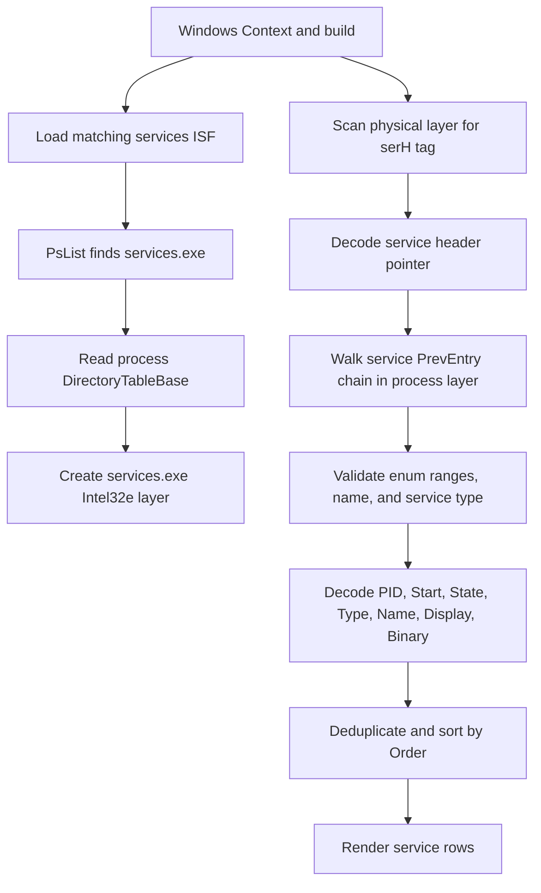
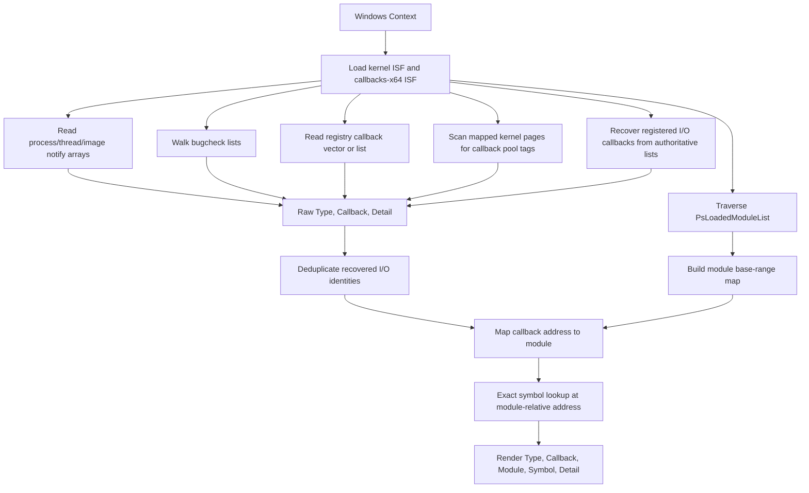
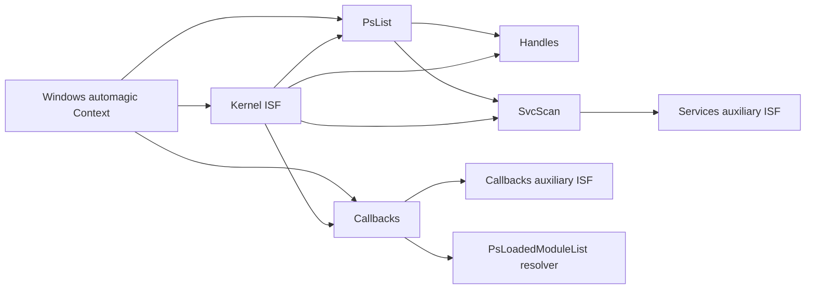
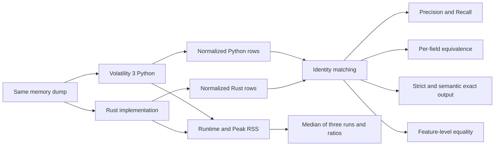

# Rekap Pengembangan Rust Volatility untuk Windows

Dokumen ini memetakan pengembangan modul Windows pada `RUSTVOL3` dari tahap
awal sampai hasil audit dan benchmark tanggal 12 Oktober 2026. Fokus penelitian
adalah migrasi selektif empat plugin Volatility 3 ke Rust untuk Windows 10/11
x64: `pslist`, `handles`, `svcscan`, dan `callbacks`.

## 1. Ringkasan kontribusi utama

Pengembangan ini bukan konversi seluruh Volatility 3 Python ke Rust. Pendekatan
yang digunakan adalah **feature-guided selective migration**: hanya jalur
akuisisi, automagic, simbol, dan plugin yang diperlukan oleh artefak penelitian
yang diimplementasikan.

Kontribusi teknis yang paling penting adalah:

1. Menambahkan jalur pembacaan memory Windows x64 ke arsitektur Rusting
   Volatility yang semula berorientasi Linux.
2. Menambahkan dukungan dua bentuk akuisisi utama:
   - QEMU ELF64 core, termasuk file berekstensi `.vmem` tetapi berisi ELF;
   - VMware native `.vmem` dengan sidecar `.vmsn` atau `.vmss`.
3. Mengembangkan Windows automagic untuk menemukan CR3/DTB, kernel base,
   identitas PDB, ISF kernel, build Windows, serta auxiliary ISF.
4. Mengembangkan empat plugin Windows dengan layout struktur yang diambil
   secara dinamis dari ISF, bukan hard-coded untuk satu build.
5. Menambahkan renderer CSV, JSON, JSONL, dan pretty output pada CLI yang sama.
6. Melakukan audit field-by-field terhadap Volatility 3 Python dan benchmark
   runtime serta Peak RSS pada 26 memory dump.

## 2. Batas dukungan saat ini

| Aspek | Dukungan saat ini |
|---|---|
| Arsitektur | Windows x64/Intel32e |
| Versi target penelitian | Windows 10 dan Windows 11 |
| QEMU | ELF64 core dengan CPU state pada PT_NOTE QEMU |
| VMware | `.vmem` dengan sidecar `.vmsn`/`.vmss` yang memuat `CR64` dan `IDTR` |
| File flat tanpa metadata | Dapat dibaca sebagai physical layer, tetapi automagic CPU state belum tersedia; memerlukan `--dtb`, `--kernel-base`, dan ISF yang sesuai |
| Simbol kernel | ISF `.json` atau `.json.xz` yang identitas PDB-nya cocok |
| Output | CSV, JSON, JSONL, dan pretty text |
| Plugin | PsList, Handles, SvcScan, Callbacks |

Ekstensi file bukan satu-satunya penentu format. CLI memeriksa signature ELF
lebih dahulu karena beberapa dump BCCC bernama `.vmem` sebenarnya adalah QEMU
ELF core. Pemeriksaan VMware berbasis ekstensi dan keberadaan sidecar dilakukan
setelah pemeriksaan signature tersebut.

Catatan penting: `WINDOWS_AUTOMAGIC.md` masih menyebut opsi
`--download-symbols`, tetapi opsi itu **tidak terdapat pada CLI source saat
ini**. Implementasi aktif mengekstrak identitas PDB dan mencari exact ISF di
repository lokal; bila ISF tidak tersedia, provisioning masih dilakukan di
luar command Rust.

## 3. Arsitektur berlapis

Arsitektur mengikuti pola Rusting Volatility: input tidak langsung dibaca oleh
plugin. Data melewati physical/container layer, translation layer, symbol
layer, context, plugin, dan renderer. Pemisahan ini membuat plugin tidak perlu
mengetahui apakah memory berasal dari QEMU atau VMware.



### Peran crate dan file utama

| Komponen | Peran |
|---|---|
| `vol3-layers/src/physical.rs` | Akses file: mmap untuk random access dan streaming untuk full-image scan |
| `vol3-layers/src/elf.rs` | Memetakan ELF `PT_LOAD` menjadi ruang alamat fisik guest |
| `vol3-layers/src/vmware.rs` | Membaca metadata VMware, region memory, `CR64`, dan `IDTR` |
| `vol3-layers/src/intel.rs` | Translasi virtual-to-physical Intel32e, termasuk Windows transition PTE dan large pages |
| `vol3-symbols/src/isf.rs` | Memuat simbol dan layout struktur dari ISF JSON/XZ |
| `vol3-framework/src/context.rs` | Menyimpan layer, symbol table, dan parameter automagic bersama |
| `vol3-framework/src/windows_automagic.rs` | Menemukan kernel PE, PDB identity, CR3, kernel base, dan build |
| `vol3-plugins-windows/src/*.rs` | Implementasi empat plugin dan layout Windows |
| `vol3-renderers/src/*.rs` | Serialisasi hasil ke CSV dan JSON |
| `vol3-cli/src/main.rs` | Deteksi format, pembentukan context, pemilihan plugin, filter, dan renderer |

## 4. Cara Rust membaca memory Windows

### 4.1 Physical/container layer

CLI memilih `StreamingFileLayer` untuk `svcscan` dan `callbacks` karena kedua
plugin melakukan scanning besar. Tujuannya adalah menghindari seluruh dump
multi-gigabyte menjadi working set mmap. Plugin random-access menggunakan
`FileLayer`.

Setelah file dibuka:

1. Bila signature adalah ELF64, `Elf64Layer` memetakan setiap `PT_LOAD`.
2. Bila terdapat sidecar VMware, `VmwareLayer` membaca region:
   - `regionPPN` sebagai alamat fisik guest;
   - `regionPageNum` sebagai offset page dalam `.vmem`;
   - `regionSize` sebagai panjang region.
3. Bila keduanya tidak cocok, file diperlakukan sebagai flat physical layer.

### 4.2 CPU state dan DTB/CR3

Windows virtual memory tidak dapat dianalisis hanya dari byte fisik; diperlukan
page-table root atau CR3.

- Pada QEMU ELF, parser membaca PT_NOTE bernama `QEMU`, lalu mengambil CR3 dan
  IDTR dari state x86_64.
- Pada VMware, parser membaca group `cpu`; `CR64[3]` adalah CR3 dan tag `IDTR`
  berisi limit serta base IDT.
- Lower 12 bit CR3 dibersihkan untuk memperoleh alamat page-aligned DTB.

### 4.3 Translasi Intel32e khusus Windows

`Intel32e::new_windows` melakukan page-table walk empat tingkat:
PML4 → PDPT → PD → PT. Layer ini menangani page 4 KiB, large page 2 MiB, huge
page 1 GiB, serta transition PTE Windows. Hasilnya adalah virtual kernel layer
yang dapat dibaca oleh plugin menggunakan alamat virtual Windows.

### 4.4 Kernel base dan PDB identity

IDTR dipakai sebagai anchor karena interrupt handler harus menunjuk ke kernel:

1. Decode 256 IDT gate untuk mencari handler canonical kernel.
2. Align handler pada boundary 2 MiB.
3. Scan mundur maksimum 128 MiB untuk signature `MZ` dan PE AMD64.
4. Parse PE debug directory.
5. Ambil record CodeView `RSDS`: nama PDB, GUID, dan age.
6. Bentuk identifier `<GUID>-<age>` dan pilih exact ISF lokal pada path yang
   mengandung `<database>/<GUID>-<age>`.

### 4.5 Validasi ISF dan build

ISF kandidat tidak langsung dipercaya. Automagic memeriksa:

- `NtBuildNumber` berada pada rentang masuk akal 10.000–40.000;
- `PsActiveProcessHead.Flink` dan `.Blink` merupakan canonical kernel address.

Build yang tervalidasi menentukan auxiliary service ISF, sedangkan plugin
callbacks memakai `callbacks-x64.json`. Context kemudian menyimpan `primary`,
`physical`, `nt_symbols`, `kernel_virtual_offset`, build, PDB identity, dan
path auxiliary symbols.

### Flow automagic Windows



## 5. Urutan pengembangan dari awal

1. **Pemilihan scope.** Migrasi dibatasi ke Windows 10/11 x64 dan empat plugin
   agar penelitian tiga bulan tetap realistis.
2. **Kontrak plugin Windows.** Ditentukan bahwa plugin menerima kernel virtual
   layer, kernel ISF, dan kernel virtual offset dari `Context`.
3. **PsList pertama.** Implementasi awal memakai DTB, kernel base, dan ISF
   manual. Ini membuktikan end-to-end read → translate → symbol → artifact.
4. **Handles.** PsList dijadikan reusable primitive untuk menemukan seluruh
   `_EPROCESS` sebelum tabel handle tiap proses didecode.
5. **SvcScan.** Ditambahkan process-specific address space dan physical tag
   scanning untuk record service.
6. **Automagic QEMU.** CR3/IDTR, kernel PE, PDB RSDS, exact ISF, dan build dapat
   ditemukan tanpa tiga parameter manual.
7. **Automagic VMware.** Parser `.vmsn/.vmss`, memory segmentation, `CR64`, dan
   `IDTR` ditambahkan sehingga VMware Windows 10 dapat memakai command yang
   sama.
8. **Callbacks.** Lima sumber callback Volatility direplikasi, lalu ditambah
   complementary authoritative-list recovery untuk capture VMware.
9. **Audit fidelity.** Handles memperoleh File device path dan Registry Key
   path; callbacks memperoleh module/symbol resolver berbasis
   `PsLoadedModuleList`; semantik detail diselaraskan dengan Python.
10. **Validasi akhir.** Unit test, equivalence field-by-field, tiga repetisi
    runtime, dan Peak RSS dijalankan pada 26 dump.

## 6. Plugin PsList

### Fungsi

Menghasilkan daftar proses aktif Windows dari `PsActiveProcessHead`. Plugin ini
juga menjadi dependency internal bagi Handles dan SvcScan.

### Cara pengembangan

1. `EprocessLayout` mengambil offset field secara dinamis dari kernel ISF.
2. Alamat list head dihitung sebagai `kernel_base + PsActiveProcessHead RVA`.
3. Linked list ditelusuri melalui `Flink` dan `Blink`.
4. Alamat `_EPROCESS` diperoleh dengan metode container-of:
   `LIST_ENTRY - offset(ActiveProcessLinks)`.
5. Kedua arah dideduplicate; repeated pointer, null pointer, dan safety limit
   mencegah infinite loop pada dump yang smeared/corrupt.
6. Field PID, PPID, image name, threads, handle count, session, WOW64,
   CreateTime, dan ExitTime didecode.
7. `--pid` diterapkan setelah enumerasi untuk mempertahankan primitive yang
   dapat dipakai plugin lain.

### Flow PsList



### Output utama

`PID`, `PPID`, `ImageFileName`, `Offset(V)`, `Threads`, `Handles`, `SessionId`,
`Wow64`, `CreateTime`, dan `ExitTime`.

## 7. Plugin Handles

### Fungsi

Menginventarisasi kernel object yang dibuka oleh setiap proses, termasuk
object type, access mask, handle value, object address, dan nama object.

### Cara pengembangan

1. Reuse PsList untuk memperoleh `_EPROCESS` dan opsi filter PID.
2. Baca `_EPROCESS.ObjectTable` → `_HANDLE_TABLE.TableCode`.
3. Decode level tabel 0–2 dan telusuri page/subtable secara rekursif.
4. Decode `_HANDLE_TABLE_ENTRY` Windows 8+:
   - compressed object-pointer bitfield;
   - `GrantedAccessBits`;
   - handle value berdasarkan index × 4.
5. Bentuk canonical x64 `_OBJECT_HEADER` dan decode `TypeIndex` menggunakan
   `ObHeaderCookie` bila tersedia.
6. Bentuk dynamic type map dari `ObTypeIndexTable`/`ObpObjectTypes`.
7. Decode nama berdasarkan type:
   - Process: image name dan PID;
   - Thread: TID dan PID dari `_CLIENT_ID`;
   - File: nama DeviceObject digabung dengan `_FILE_OBJECT.FileName`;
   - Key: rekonstruksi parent chain `_CM_KEY_CONTROL_BLOCK`;
   - type lain: `_OBJECT_HEADER_NAME_INFO` melalui `ObpInfoMaskToOffset`.
8. Filter `--pid` dan `--type` diterapkan sebelum rendering.

### Flow Handles



### Audit penting

Versi awal cocok pada identitas handle tetapi belum seluruh nama. Audit akhir
menambahkan DeviceObject path untuk File dan full Registry Key path. Hasil
akhir cocok pada 1.279.083 nilai field Process/Offset/Type/GrantedAccess/Name.

## 8. Plugin SvcScan

### Fungsi

Memulihkan record Windows service dari memory `services.exe`, termasuk status,
startup type, service type, PID, display name, dan binary path.

### Cara pengembangan

1. Pilih service ISF berdasarkan build Windows yang ditemukan automagic.
2. Gunakan PsList untuk menemukan `_EPROCESS` milik `services.exe`.
3. Baca `_KPROCESS.DirectoryTableBase` proses tersebut.
4. Bentuk Intel32e process layer menggunakan DTB `services.exe`.
5. Scan physical memory untuk pool tag `serH`.
6. Dari service header, ambil pointer record pertama.
7. Traverse chain melalui `PrevEntry` dan deduplicate alamat record.
8. Validasi `Order`, `Start`, `State`, service type, dan service name untuk
   menolak false positive.
9. Decode UTF-16 Name/Display/Binary dan PID dari process-or-driver union.
10. Urutkan hasil dengan order descending, lalu render.

### Flow SvcScan



### Audit penting dan keterbatasan

Rust memakai physical pool discovery, sedangkan Python dapat memilih record
atau alias dari VAD scanning. Akibatnya `Offset` tidak selalu sama meskipun
identitas service dan field semantiknya sama. Pada 26 dump:

- precision dan recall: 1,0;
- strict field equivalence: 0,876206 karena `Offset` diaudit;
- semantic field equivalence: 0,999959;
- semantic exact: 21/26 karena lima nilai `Binary` belum terisi di Rust;
- feature-level exact: 26/26.

## 9. Plugin Callbacks

### Fungsi

Menginventarisasi callback kernel yang dapat digunakan untuk mendeteksi driver,
hook, atau mekanisme persistensi kernel. Output memuat type, callback address,
module, exact symbol, dan detail.

### Cara pengembangan

Plugin mereplikasi sumber artefak Volatility 3 berikut:

1. Notify arrays:
   `PspLoadImageNotifyRoutine`, `PspCreateThreadNotifyRoutine`, dan
   `PspCreateProcessNotifyRoutine`.
2. `KeBugCheckCallbackListHead`.
3. `KeBugCheckReasonCallbackListHead`.
4. Registry callback melalui `CmpCallBackVector` atau `CallbackListHead`.
5. Pool-tag scan untuk `IoFs`, `IoSh`, `Cbrb`, `DbCb`, `Pnp9`, `PnpD`, dan
   `PnpC`.

Untuk VMware, authoritative kernel lists juga ditelusuri sebagai recovery
pelengkap bagi I/O callback yang pool page-nya tidak terlihat oleh page-table
scan sederhana. Hasil recovery dideduplicate berdasarkan Type + Callback.

Audit akhir menambahkan `ModuleResolver`:

1. Traverse `PsLoadedModuleList`.
2. Decode `DllBase`, `SizeOfImage`, dan `BaseDllName` dari
   `_KLDR_DATA_TABLE_ENTRY` atau fallback `_LDR_DATA_TABLE_ENTRY`.
3. Cari module range yang mencakup callback address.
4. Hitung alamat relatif terhadap module base.
5. Lakukan exact symbol lookup pada kernel symbol table.

### Flow Callbacks



### Audit penting

Sebelum module resolver, Type + Callback sudah cocok tetapi Module/Symbol belum
sepenuhnya equivalent. Setelah audit, seluruh Module, Symbol, dan Detail cocok
pada 6.756 callback rows dari 26 dump.

## 10. Hubungan antar-plugin



PsList bukan hanya output plugin, tetapi reusable enumeration primitive.
Handles membutuhkan daftar proses untuk setiap ObjectTable. SvcScan memakai
PsList untuk menemukan process address space `services.exe`. Callbacks tidak
membutuhkan PsList, tetapi memakai kernel module list untuk memperkaya alamat
callback menjadi module dan symbol.

## 11. Output dan command

Contoh automagic:

```powershell
vol3.exe --file "D:\Memory Dump Thesis\7512\7512_1.vmem" --os windows --show-automagic --output json ps-list
vol3.exe --file "D:\Memory Dump Thesis\7512\7512_1.vmem" --os windows --output csv handles
vol3.exe --file "D:\Memory Dump Thesis\7512\7512_1.vmem" --os windows --output json svc-scan
vol3.exe --file "D:\Memory Dump Thesis\7512\7512_1.vmem" --os windows --output json callbacks
```

Filter PID tersedia pada PsList dan Handles:

```powershell
vol3.exe --file "dump.vmem" --os windows --output json ps-list --pid 7512
vol3.exe --file "dump.vmem" --os windows --output csv handles --pid 7512
```

`--file` menerima path lengkap. Automagic tetap dijalankan untuk seluruh dump;
PID filter adalah filter plugin setelah context Windows berhasil dibentuk.

## 12. Strategi equivalence dan benchmark

Validasi tidak hanya menghitung jumlah baris. Urutannya adalah:



Identitas per plugin:

| Plugin | Identity key |
|---|---|
| PsList | `Offset(V)` |
| Handles | `PID + HandleValue` |
| SvcScan | `Name` |
| Callbacks | `Type + Callback` |

Pengukuran akhir berisi 26 dump × 4 plugin × 2 engine × 3 run = 624 baris,
semuanya berhasil. Tiga plugin yang berubah setelah audit diukur ulang khusus
Rust secara sequential sebanyak 234 run; baseline Python dan PsList dibekukan.

## 13. Status akhir yang dapat diklaim

| Plugin | Precision | Recall | Field/semantic result | Exact status | Geometric speedup | Peak RSS ratio Python/Rust |
|---|---:|---:|---|---|---:|---:|
| PsList | 1,0 | 1,0 | 1,0 | 26/26 strict exact | 50,19× | 2,48× |
| Handles | 1,0 | 1,0 | 1,0 | 26/26 strict exact | 33,94× | 2,64× |
| SvcScan | 1,0 | 1,0 | 0,999959 semantic | 21/26 semantic exact; 26/26 feature exact | 2,96× | 1,92× |
| Callbacks | 1,0 | 1,0 | 1,0 | 26/26 strict exact | 2344,82× | 3,46× |

Angka callbacks menggunakan baseline Python lama yang dibekukan; hanya sisi
Rust yang diukur ulang setelah audit. Oleh karena itu angka tersebut harus
ditulis bersama protokol pengukurannya dan tidak dipresentasikan sebagai
benchmark paired baru.

## 14. Poin yang perlu di-highlight dalam tesis

1. **Selective, bukan full rewrite.** Novelty berada pada pemilihan artefak dan
   migrasi jalur minimum yang tetap dapat diuji secara objektif.
2. **Format-independent plugin layer.** Plugin menerima virtual layer dan
   Context yang sama meskipun input berasal dari QEMU atau VMware.
3. **Exact symbol identity.** Automagic memilih ISF berdasarkan RSDS PDB GUID
   dan age, bukan hanya berdasarkan tebakan versi Windows.
4. **Layout dinamis.** Offset struktur berasal dari ISF sehingga implementasi
   tidak mengunci satu build Windows 10/11.
5. **Reuse internal.** PsList menjadi primitive untuk Handles dan SvcScan;
   pengembangan tidak menduplikasi enumerasi proses.
6. **Fidelity-aware engineering.** Audit tidak berhenti pada jumlah record;
   File path, Registry path, module, symbol, detail, dan provenance ikut diuji.
7. **Strict versus semantic equivalence.** Perbedaan alamat penemuan SvcScan
   dilaporkan transparan, tidak disembunyikan sebagai 100% exact.
8. **Resource-aware scanning.** Streaming input dan mapped-page scanning
   mengurangi working set dan menghindari interpretasi stale physical pool.
9. **Reproducible evaluation.** Raw JSON, normalized comparison, measurements,
   manifest, backup, serta grafik PNG/SVG disimpan sebagai evidence.
10. **Batas klaim jelas.** Hasil membuktikan equivalence dan performa pada
    corpus yang diuji, bukan dukungan universal seluruh versi Windows atau
    validitas klasifikasi CIC-MalMem-2022.

## 15. Keterbatasan dan pekerjaan selanjutnya

1. Automagic raw/flat capture tanpa CPU metadata belum lengkap.
2. Provisioning exact ISF belum merupakan opsi aktif pada CLI saat ini.
3. SvcScan masih memiliki lima `Binary` value yang tidak terisi dan perbedaan
   provenance `Offset` terhadap Python.
4. Scope x64 Windows 10/11 belum membuktikan dukungan Windows 7/8 atau x86.
5. Hanya empat plugin yang dimigrasikan; framework belum setara dengan seluruh
   katalog Volatility 3 Windows.
6. Benchmark callbacks perlu selalu dijelaskan sebagai perbandingan terhadap
   baseline Python yang dibekukan, bukan paired rerun pascaaudit.

## 16. Lokasi evidence

- Source Windows: `vol3-plugins-windows/src/`
- Windows automagic: `vol3-framework/src/windows_automagic.rs`
- VMware layer: `vol3-layers/src/vmware.rs`
- Intel32e layer: `vol3-layers/src/intel.rs`
- CLI orchestration: `vol3-cli/src/main.rs`
- Audit equivalence: `../benchmark/results/audit_fix_validation_final_20261012/`
- Benchmark final: `../benchmark/results/final equivalence test/`

